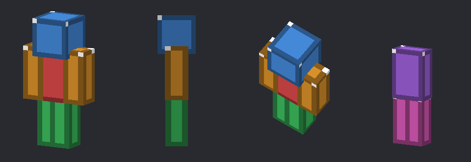

# Minecraft Armor Tools for Aseprite

An Aseprite extension for drawing Minecraft armor textures. It shows where
every body part goes, links the two armor texture files together and gives
you a live 3D preview while you draw.



## Features

- **Armor detection**: open a 64×32 texture (or an HD one like 128×64) and
  the extension asks if you want to work on it as armor. It remembers your
  answer for each file.
- **Body-part grids**: coloured outlines show every face of every part
  (front, back, sides, top and bottom). They're only guides and are never
  saved into your PNG.
- **Two files, one set**: armor is split over two textures. The extension
  finds the matching file and can open it for you.
- **Live 3D preview**: see the helmet, chestplate, leggings and boots on a 3D
  model. It updates after every stroke, even before you save.
- **Save both at once**: save the whole armor set with one command.

## Install

1. Download `minecraft-armor-tools.aseprite-extension` from the
   [latest release](https://github.com/CraftlyWorks/aseprite-minecraft-armor/releases/latest).
2. Double-click the file, or in Aseprite go to
   *Edit > Preferences > Extensions > Add Extension* and pick it.
3. That's it. You'll find everything under *View > Minecraft Armor*.

To update, install the new file the same way. To remove the extension, go to
*Edit > Preferences > Extensions*, select it and click *Uninstall*.

## Supported versions

| | |
|---|---|
| Aseprite | 1.3 or newer (tested on 1.3.17 and 1.3.18) |
| Systems | Windows, macOS and Linux |
| Minecraft | Java Edition armor textures, both the 1.21.2+ format and the older one |
| Texture sizes | 64×32 and HD sizes (128×64, 256×128, ...) |

Menu check marks and resizing the preview window need Aseprite 1.3.15 or
newer. Everything else works on 1.3.

## How to use

1. Open an armor texture, for example
   `assets/minecraft/textures/entity/equipment/humanoid/iron.png`.
2. Click **Work as Armor** in the popup. Keep "Also open ..." ticked to open
   the leggings texture as well.
3. Draw. The preview follows along.

Armor uses two texture files:

| File | Holds | Older packs |
|---|---|---|
| Layer 1: `equipment/humanoid/<name>.png` | Helmet, chestplate, boots | `models/armor/<name>_layer_1.png` |
| Layer 2: `equipment/humanoid_leggings/<name>.png` | Leggings | `models/armor/<name>_layer_2.png` |


Layer 1 is on the left, Layer 2 on the right. Blue is the helmet, light blue
the helmet overlay, red the chestplate, orange the arms, green the boots,
purple the leggings waist and pink the leggings legs. The white pixel marks
the top-left corner of each face.

## Commands

All commands are in *View > Minecraft Armor*.

| Command | What it does |
|---|---|
| 3D Armor Preview | Opens or closes the preview window |
| Work on This as Armor... | Asks again for the current file, e.g. to switch between Layer 1 and Layer 2 |
| Armor Grids... | Turns the grids on or off, for each piece |
| Save Armor Set | Saves both textures of the set |
| Saving One Texture Saves Both | When ticked, saving one texture also saves the other |
| Stop Treating This as Armor | Removes the grids and forgets the file |

Tip: give *Save Armor Set* a shortcut in *Edit > Keyboard Shortcuts*.

## Preview controls

| To | Do this |
|---|---|
| Rotate | Drag |
| Move | Right-drag or Shift + drag |
| Zoom | Scroll or pinch |
| Reset the view | Double-click |
| Show or hide a piece | Use the checkboxes under the preview |
| Jump to an angle | Click Front, Side, Back or 3/4 |

## Good to know

- The grids are Aseprite slices, which PNG files don't store, so your
  texture stays clean. Adding them marks a freshly opened PNG as changed;
  saving it writes the same pixels back.
- The preview reads open tabs directly, so it shows unsaved changes. Files
  that aren't open are read from disk; *Reload from Disk* refreshes them.
- The left arm and left leg use the same pixels as the right ones, mirrored,
  just like in Minecraft.

## For developers

```
src/     the extension
tests/   tests that run in Aseprite's batch mode
docs/    README images (made by docs/make_images.lua)
```

| File | Purpose |
|---|---|
| `src/main.lua` | Menu commands, the armor popup and linking the two files |
| `src/mca_layout.lua` | Armor texture layout and file name rules |
| `src/mca_grids.lua` | Body-part grids |
| `src/mca_preview.lua` | Preview window |
| `src/mca_render.lua` | 3D renderer |
| `src/mca_compat.lua` | File paths on every system and support for older Aseprite versions |

- `./build.sh` builds `dist/minecraft-armor-tools.aseprite-extension`.
- `tests/run.sh` runs all tests. Set `ASEPRITE` to your Aseprite program if
  it isn't found. On Windows, run the scripts from Git Bash or WSL.

## License

[MIT](LICENSE)
